  

  
  

I'm a data analyst in Dubai with 3+ years across operations and marketing operations. Most of my work starts with a slow manual process in Excel and ends with a script, a cleaner dataset and a report people can trust.

- I automated Salesforce Marketing Cloud data extension builds and cut them from about 60 to 20 minutes per campaign
- I've tracked 500 to 600 pallet deliveries a month across four regional warehouses
- I hold an Advanced Data Science Certification from IIT Madras and the University of Toronto

## Projects

| Project | What it does | Stack |
| --- | --- | --- |
| [DET Automation Tool](https://github.com/Roystan-passanha/DET-Automation-Tool) | Builds and validates SFMC import files from Excel. 60 → 20 minutes per campaign | Python, openpyxl, PySide6 |
| [HR Data Quality Tool](https://github.com/Roystan-passanha/hr-data-quality-tool) | Flags passport, visa and data errors in HR master files with source row numbers | Python, pandas, Streamlit |
| [Logistics SQL Analysis](https://github.com/Roystan-passanha/logistics-sql-analysis) | On-time delivery, delay causes and peak-season impact across four warehouses | SQL, SQLite, window functions |
| [Email Campaign ETL](https://github.com/Roystan-passanha/email-campaign-etl) | Cleans email platform exports, removes scanner clicks, reports campaign KPIs | Python, pandas, SQLite |

Each repository has tests that run on every push with GitHub Actions.

## Tools I use

## Experience

- **Genpact**, Senior Associate (2025 – 2026): data extensions and SFMC email templates for Gannett campaigns
- **ReachLocal**, Operations Support Analyst (2024 – 2025): about 25 campaign emails a week, built the DET tool
- **LEAP India**, Warehouse Executive (2023 – 2024): delivery tracking and reporting across four regions
